<div align="center">


# PicturaAI

### Turn a photo into a painting.

Van Gogh, Hokusai, Klimt, Munch and ten more public-domain masters.<br>
Free, no sign-up, no watermark. On most devices your photo never leaves your browser.

[](https://picturaai-k7q6.onrender.com/app/)
[](https://picturaai-k7q6.onrender.com/app/styles/)
[](https://picturaai-k7q6.onrender.com/docs)

[](https://github.com/shashankpc7746/PicturaAI/releases/tag/v2.0)
[](https://github.com/shashankpc7746/PicturaAI/actions/workflows/ci.yml)


[](LICENSE)

<br>

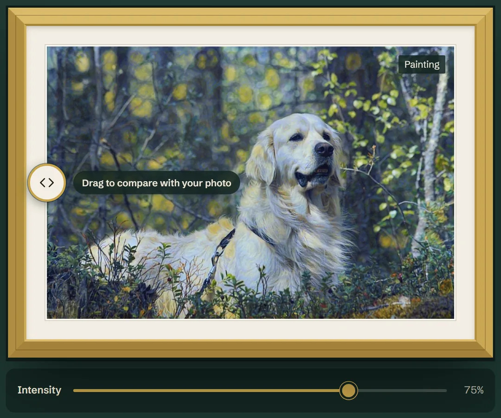

<sub>Drag the slider and the picture changes as you move it: no new request, no waiting.</sub>

</div>

---

## One photo, six paintings

<p align="center">
  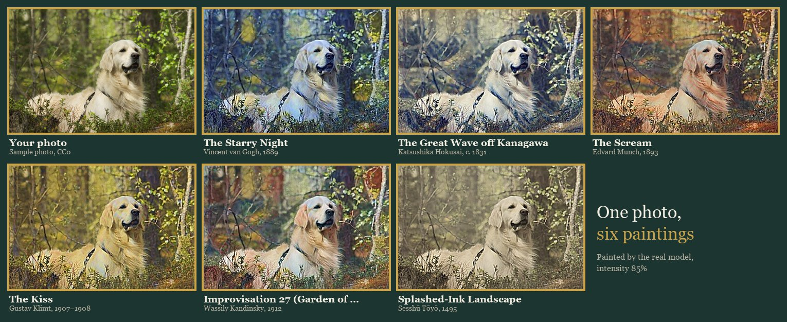
</p>

*Pictura* is Latin for "a painting". Your photo hangs in a gilt frame on a green museum
wall; pick a painting and the photo is repainted in its style in a few seconds, then
fine-tune it live. On most computers and recent phones the model runs **in your
browser**, so the photo is never uploaded.

## The collection

<p align="center">
  <a href="https://picturaai-k7q6.onrender.com/app/styles/">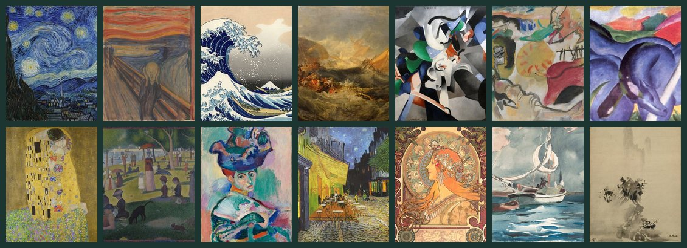</a>
</p>

<table>
<tr>
<td><a href="https://picturaai-k7q6.onrender.com/app/styles/van-gogh-starry-night/">The Starry Night</a><br><sub>Van Gogh, 1889</sub></td>
<td><a href="https://picturaai-k7q6.onrender.com/app/styles/munch-the-scream/">The Scream</a><br><sub>Munch, 1893</sub></td>
<td><a href="https://picturaai-k7q6.onrender.com/app/styles/hokusai-great-wave/">The Great Wave</a><br><sub>Hokusai, c. 1831</sub></td>
<td><a href="https://picturaai-k7q6.onrender.com/app/styles/turner-shipwreck/">The Wreck of a Transport Ship</a><br><sub>Turner, c. 1810</sub></td>
<td><a href="https://picturaai-k7q6.onrender.com/app/styles/picabia-udnie/">Udnie</a><br><sub>Picabia, 1913</sub></td>
<td><a href="https://picturaai-k7q6.onrender.com/app/styles/kandinsky-improvisation-27/">Improvisation 27</a><br><sub>Kandinsky, 1912</sub></td>
<td><a href="https://picturaai-k7q6.onrender.com/app/styles/marc-large-blue-horses/">The Large Blue Horses</a><br><sub>Marc, 1911</sub></td>
</tr>
<tr>
<td><a href="https://picturaai-k7q6.onrender.com/app/styles/klimt-the-kiss/">The Kiss</a><br><sub>Klimt, 1907–08</sub></td>
<td><a href="https://picturaai-k7q6.onrender.com/app/styles/seurat-grande-jatte/">La Grande Jatte</a><br><sub>Seurat, 1884–86</sub></td>
<td><a href="https://picturaai-k7q6.onrender.com/app/styles/matisse-woman-with-a-hat/">Woman with a Hat</a><br><sub>Matisse, 1905</sub></td>
<td><a href="https://picturaai-k7q6.onrender.com/app/styles/van-gogh-cafe-terrace-at-night/">Café Terrace at Night</a><br><sub>Van Gogh, 1888</sub></td>
<td><a href="https://picturaai-k7q6.onrender.com/app/styles/mucha-zodiac/">Zodiac</a><br><sub>Mucha, 1896</sub></td>
<td><a href="https://picturaai-k7q6.onrender.com/app/styles/homer-sloop-nassau/">Sloop, Nassau</a><br><sub>Homer, 1899</sub></td>
<td><a href="https://picturaai-k7q6.onrender.com/app/styles/sesshu-splashed-ink-landscape/">Splashed-Ink Landscape</a><br><sub>Sesshū, 1495</sub></td>
</tr>
</table>

Every painting is in the public domain, with its source and licence on the
[credits page](https://picturaai-k7q6.onrender.com/app/credits.html) and in
[`docs/revamp/presets/README.md`](docs/revamp/presets/README.md).

## What you can do

| | |
|---|---|
| **Paint with a masterpiece** | Pick one of 14 paintings, upload a painting of your own, or *describe a style in words* |
| **Live intensity** | The slider sits right under the frame and repaints as you drag, with no new request |
| **Before / after** | Drag the grip on the picture's edge to compare with your photo |
| **Paint a region** | Brush where the style goes, or one tap on *Style the subject* / *Style the background* |
| **Mix two styles** | Blend a second painting in, with an adjustable share |
| **Colours only** | Keep your photo and take just the painting's palette |
| **Take it with you** | Download (full size, Instagram, A4 print), Share, or *Animate* a 0→100% reveal video |
| **My gallery** | Save paintings on this device (IndexedDB); no account needed |
| **Private by design** | No accounts, no cookies, no tracking ([privacy](https://picturaai-k7q6.onrender.com/app/privacy.html)) |

## Looks right on every screen

<table>
<tr>
<th>Laptop</th>
<th>Phone</th>
</tr>
<tr>
<td>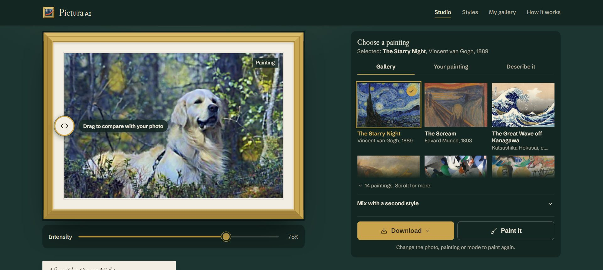</td>
<td width="30%"></td>
</tr>
</table>

<details>
<summary><b>More screenshots</b>: tablet, a painting's page, region painting, My gallery</summary>
<br>

| Tablet | A painting's page |
|---|---|
| 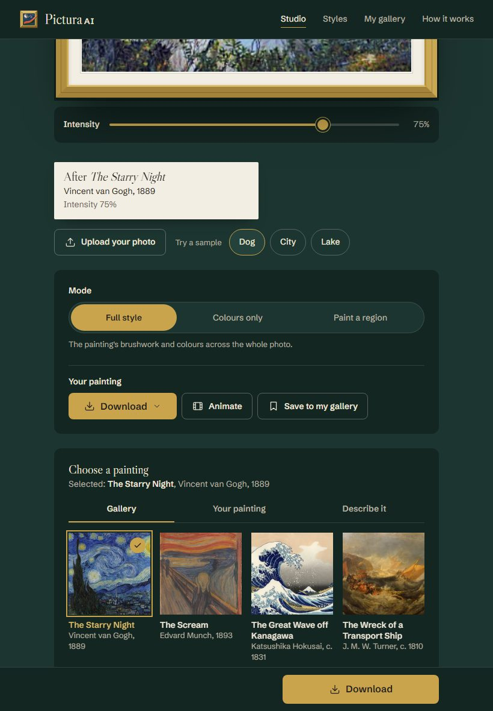 | 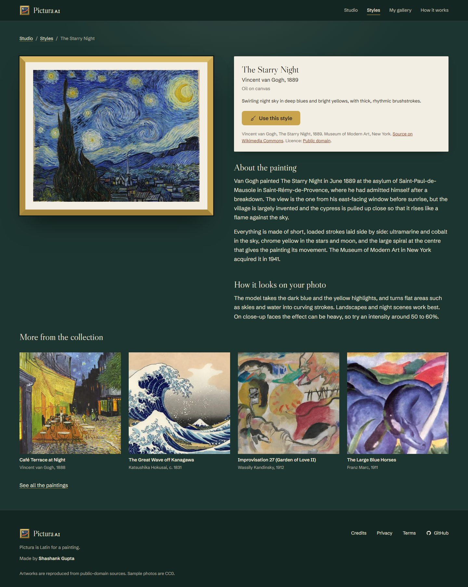 |

| Paint a region | My gallery |
|---|---|
| 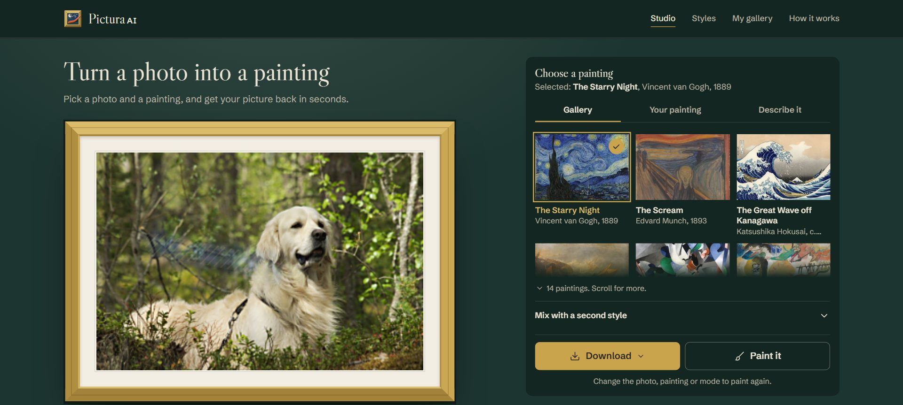 | 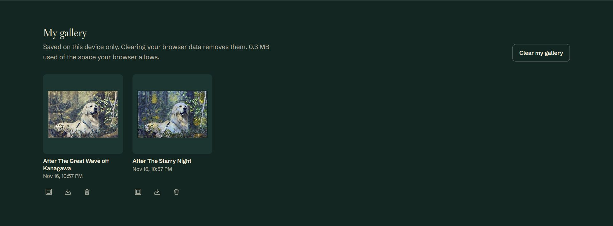 |

All screenshots, at seven screen sizes: [`docs/revamp/after/final/`](docs/revamp/after/final).
</details>

<details>
<summary><b>Before and after the redesign</b></summary>
<br>

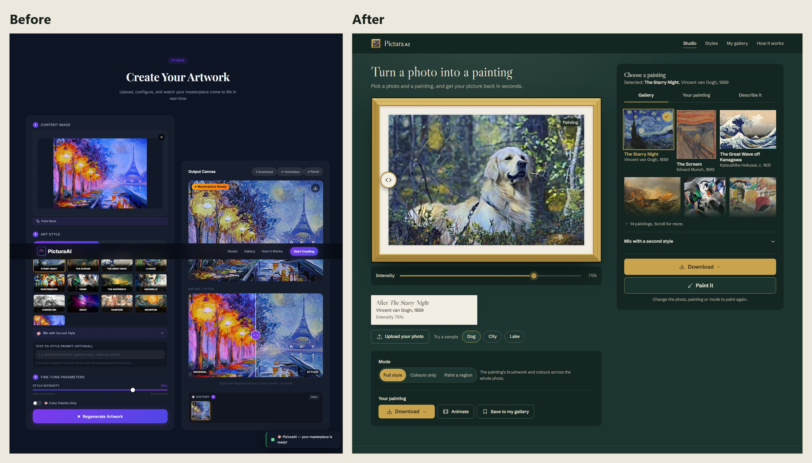
</details>

## How it works

Both engines run the same model, Google Magenta's
[arbitrary-image-stylization-v1-256](https://tfhub.dev/google/magenta/arbitrary-image-stylization-v1-256/2)
(one forward pass, no training), and finish in the same browser compositor.

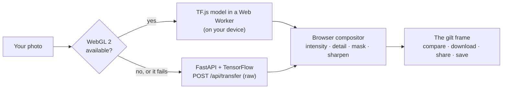

- **On your device** (the default): the model, converted to TensorFlow.js with uint8
  weights, runs in a Web Worker so the page never freezes. Preset styles ship as
  precomputed style vectors, so a first visit downloads about 8 MB; later visits use the
  cache. Measurements: [`docs/revamp/engine/ENGINE.md`](docs/revamp/engine/ENGINE.md).
- **On the server** (fallback): returns the raw stylisation; the browser does the same
  compositing as the server's `run_nst` (parity-tested to a mean difference of 0.0000).

| Part | Stack |
|---|---|
| Frontend | Plain HTML, CSS and native ES modules: no framework, no build step (`frontend/`) |
| Backend | Python 3.12, FastAPI, Uvicorn, slowapi rate limits (`backend/`) |
| ML | TensorFlow 2.20 on the server; TensorFlow.js 4.22 and MediaPipe Tasks Vision in the browser |
| Hosting | Docker on Render's free tier (512 MB RAM) |
| Quality | 167 backend tests, 56 browser tests (Playwright), CI with a Docker build inside 512 MB |

## Run it yourself

```bash
git clone https://github.com/shashankpc7746/PicturaAI.git && cd PicturaAI
python -m venv venv
venv\Scripts\pip install -r backend\requirements.txt     # macOS/Linux: venv/bin/pip
python run.py                                            # open http://localhost:8000/app
```

The first run downloads the model (about 90 MB) into `.tfhub_cache/`. No secrets are
needed. Add `?engine=server` to the studio URL to force the server engine.

<details>
<summary><b>Docker</b></summary>
<br>

```bash
docker build -t picturaai .
docker run -p 8000:8000 --memory 512m picturaai
```
</details>

<details>
<summary><b>Configuration</b> (all optional, safe defaults)</summary>
<br>

Image size limits, rate limits, `PUBLIC_SITE_URL`, and optional Cloudflare Workers AI
(*Describe it* generation), Sentry and Cloudflare Web Analytics. The full table is in
[`docs/CLAUDE.md`](docs/CLAUDE.md#environment-variables-all-optional-defaults-in-code)
and the Render setup in [`render.yaml`](render.yaml). Secrets go in the host's
dashboard, never in the repository.
</details>

<details>
<summary><b>API</b></summary>
<br>

| Method & path | What it does |
|---|---|
| `POST /api/transfer` | Stylise a photo (`content_image` + `style_preset`, `style_image` or `text_prompt`; `intensity` 0–1; `output=final` or `raw`). The image comes back inline; nothing is stored. |
| `POST /api/palette-transfer` | Colours-only transfer |
| `POST /api/describe-style` | Words → a generated style image, or the closest painting |
| `GET /api/styles` | The collection (titles, artists, image URLs, pages, licences) |
| `GET /api/health` | Health check |

Interactive docs: [`/docs`](https://picturaai-k7q6.onrender.com/docs).
</details>

<details>
<summary><b>Tests</b></summary>
<br>

```bash
venv\Scripts\pip install -r requirements-dev.txt                   # pytest, Playwright, ruff, pip-audit
venv\Scripts\python -m playwright install chromium                 # once
venv\Scripts\python -m pytest backend/tests                        # API, catalogue, limits, site config
venv\Scripts\python -m pytest tests/e2e                            # the studio in headless Chromium (~3 min)
venv\Scripts\python -m pytest tests/e2e -m slow                    # on-device engine smoke test
venv\Scripts\python docs\revamp\engine\parity\composite_parity.py  # browser compositor vs run_nst
```

What each suite covers: [`docs/revamp/TESTING.md`](docs/revamp/TESTING.md).
[GitHub Actions](.github/workflows/ci.yml) runs them all, plus lint, a dependency
audit, a Docker build within 512 MB and the generated-files checks.
</details>

<details>
<summary><b>Project structure</b></summary>
<br>

```text
backend/            FastAPI app, style model, catalogue, site config, tests
frontend/           the studio (index.html), static pages, CSS, ES modules
  assets/js/engine/ on-device engine (TF.js worker), compositor, segmentation
  models/           TF.js model and precomputed style vectors
  styles/           generated page for each painting
data/styles.json    the collection: titles, artists, sources, licences
images/style_image/ the paintings at full size (server engine)
scripts/            build style images, static pages and style vectors
tests/e2e/          Playwright browser tests
docs/               project notes, testing, engine and preset docs, screenshots
```
</details>

## Credits and licences

- Code: [MIT](LICENSE).
- Paintings: public domain (*Improvisation 27* released as CC0 by the Metropolitan
  Museum of Art). Sample photos: CC0. Full list on the
  [credits page](https://picturaai-k7q6.onrender.com/app/credits.html).
- Magenta style model, DeepLab-v3, TensorFlow, TensorFlow.js and MediaPipe: Apache-2.0
  (licence files in [`frontend/models/`](frontend/models)).
- Fonts: Libre Caslon Display and Schibsted Grotesk, SIL Open Font License 1.1.

Contributions are welcome: see [`docs/CONTRIBUTING.md`](docs/CONTRIBUTING.md).

<div align="center">
<br>
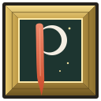<br>
<b>Made by <a href="https://github.com/shashankpc7746">Shashank Gupta</a></b>
</div>
