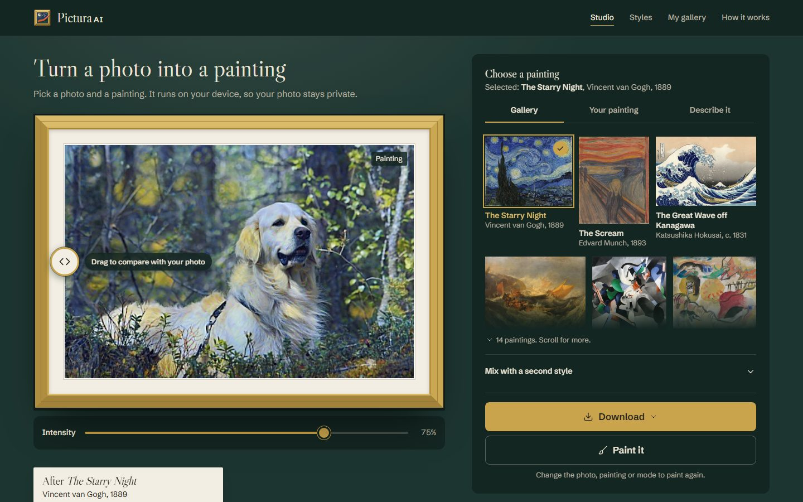
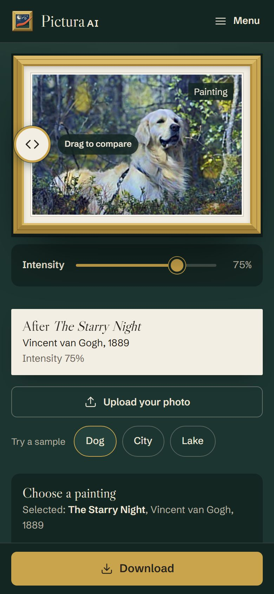

<div align="center">


# PicturaAI

Turn a photo into a painting in the style of Van Gogh, Hokusai, Klimt and other
public-domain masters. Free, with no sign-up and no watermark.

**[Open the studio](https://picturaai-k7q6.onrender.com/app/)** ·
[The collection](https://picturaai-k7q6.onrender.com/app/styles/) ·
[API docs](https://picturaai-k7q6.onrender.com/docs)

[](https://github.com/shashankpc7746/PicturaAI/actions/workflows/ci.yml)

</div>

*Pictura* is Latin for "a painting". PicturaAI is a small neural style transfer
studio: your photo hangs in a gilt frame on a green museum wall, you pick a painting,
and the photo is repainted in its style in a few seconds. On most computers and recent
phones the painting is made **in your browser**, so the photo never leaves your device.

| Desktop | Phone |
|---|---|
|  |  |


## Features

- **14 public-domain paintings** from 1495 to 1913, each with its own page
  ([the collection](https://picturaai-k7q6.onrender.com/app/styles/)). Sources and
  licences: [credits](https://picturaai-k7q6.onrender.com/app/credits.html) and
  [`docs/revamp/presets/README.md`](docs/revamp/presets/README.md).
- **Your painting**: use any painting you have the right to use as the style.
- **Describe it**: type a style in words. With Cloudflare Workers AI configured, a
  style image is generated; otherwise the closest painting in the collection is used.
- **Live intensity**: the slider sits right under the frame and changes the picture
  as you drag, without a new request.
- **Colours only**: take just the painting's palette (LAB colour matching).
- **Paint a region**: brush where the style goes, or one tap on "Style the subject" /
  "Style the background" (on-device segmentation).
- **Mix two styles** with an adjustable share.
- **Before/after**: drag the grip on the picture's edge to compare the painting with
  your photo (it shows itself once on your first result).
- **Downloads** (full size, Instagram, A4 print), **Share**, and **Animate** (a 0 to
  100% reveal video, recorded in the browser).
- **My gallery**: save paintings in the browser (IndexedDB, this device only).
- No accounts, no cookies, no tracking. See the
  [privacy page](https://picturaai-k7q6.onrender.com/app/privacy.html).

## How it works

Both engines run the same model: Google Magenta's
[arbitrary-image-stylization-v1-256](https://tfhub.dev/google/magenta/arbitrary-image-stylization-v1-256/2)
(one forward pass, no training).

- **On your device** (default when WebGL 2 is available): the model, converted to
  TensorFlow.js with uint8 weights, runs in the browser. Preset styles ship as
  precomputed style vectors, so a first visit downloads about 8 MB; later visits use
  the browser cache. Details and measurements:
  [`docs/revamp/engine/ENGINE.md`](docs/revamp/engine/ENGINE.md).
- **On the server** (fallback): `POST /api/transfer` with `output=raw` returns the raw
  stylisation from TensorFlow, and the browser does the same compositing
  (intensity blend, detail, mask, sharpening) as the server's `run_nst`.

| Part | Stack |
|---|---|
| Frontend | Plain HTML, CSS and native ES modules, no framework or build step (`frontend/`) |
| Backend | Python 3.12, FastAPI, Uvicorn, slowapi rate limits (`backend/`) |
| ML | TensorFlow 2.20 on the server, TensorFlow.js 4.22 and MediaPipe Tasks Vision in the browser |
| Hosting | Docker on Render's free tier (512 MB RAM) |

## Run locally

```bash
python -m venv venv
venv\Scripts\pip install -r backend\requirements.txt     # macOS/Linux: venv/bin/pip
python run.py                                            # http://localhost:8000/app
```

The first run downloads the model (about 90 MB) into `.tfhub_cache/`. Add
`?engine=server` to the studio URL to force the server engine. No secrets are needed.

Configuration is through environment variables, all optional with safe defaults
(image size limits, rate limits, `PUBLIC_SITE_URL`, optional Workers AI, Sentry and
Cloudflare Web Analytics). They are listed in [`CLAUDE.md`](CLAUDE.md#environment-variables-all-optional-defaults-in-code)
and declared in [`render.yaml`](render.yaml).

## Static pages

The collection, the 14 style pages and the credits page are generated from
[`data/styles.json`](data/styles.json) and
[`scripts/style_notes.json`](scripts/style_notes.json):

```bash
venv\Scripts\python scripts\build_pages.py           # write frontend/styles/**, credits.html, 404.html
venv\Scripts\python scripts\build_pages.py --check   # fail if a generated page is out of date
```

`privacy.html` and `terms.html` are written by hand between their `page-content`
markers; the script keeps their header, footer and meta tags in step with the rest.

## Testing

```bash
venv\Scripts\pip install -r requirements-dev.txt                   # pytest, Playwright, ruff, pip-audit
venv\Scripts\python -m playwright install chromium                 # once, for the browser tests
venv\Scripts\python -m pytest backend/tests                        # API, catalogue, site config
venv\Scripts\python -m pytest tests/e2e                            # studio in headless Chromium (~3 min)
venv\Scripts\python -m pytest tests/e2e -m slow                    # on-device engine smoke test (minutes)
venv\Scripts\python docs\revamp\engine\parity\composite_parity.py  # browser compositor vs run_nst (needs Node 18+)
venv\Scripts\python scripts\build_pages.py --check                  # generated pages up to date
```

The end-to-end tests start their own server and use the server engine
(`?engine=server`), because WebGL is very slow in headless Chromium. What each suite
covers, timings and how to write new tests:
[`docs/revamp/TESTING.md`](docs/revamp/TESTING.md). GitHub Actions
([`.github/workflows/ci.yml`](.github/workflows/ci.yml)) runs the backend tests, lint and
dependency audit, the e2e tests, a Docker build and start inside 512 MB, compositor
parity and the generated-files checks on every push to `main` or `revamp/**` and on pull
requests.

## Deployment

Render reads [`render.yaml`](render.yaml) and builds the [`Dockerfile`](Dockerfile),
which pre-downloads the model and runs `python backend/main.py` as a non-root user.
Pushing to `main` deploys. The free instance sleeps when idle, so the first request
after a while takes longer; the studio shows a waiting state meanwhile. Optional
secrets (Cloudflare, Sentry) go in the Render dashboard, never in the repository.

## Credits and licences

- Code: [MIT](LICENSE).
- Paintings: public domain (one, *Improvisation 27*, released as CC0 by the
  Metropolitan Museum of Art). Sample photos: CC0. Full list on the
  [credits page](https://picturaai-k7q6.onrender.com/app/credits.html).
- Magenta style model, DeepLab-v3, TensorFlow, TensorFlow.js and MediaPipe:
  Apache-2.0 (licence files in [`frontend/models/`](frontend/models)).
- Fonts: Libre Caslon Display and Schibsted Grotesk, SIL Open Font License 1.1.

Contributions are welcome: see [CONTRIBUTING.md](CONTRIBUTING.md).
